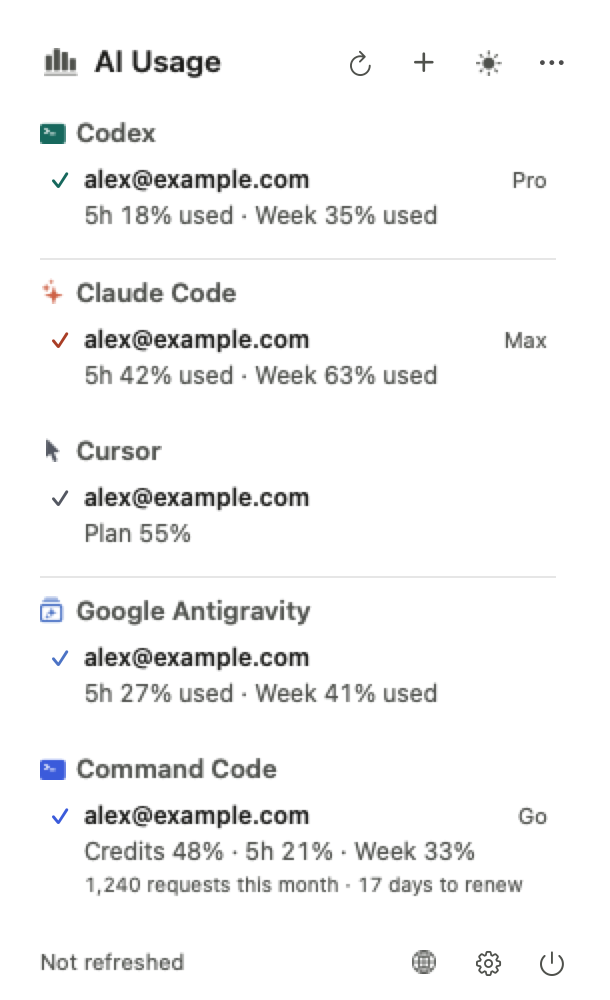
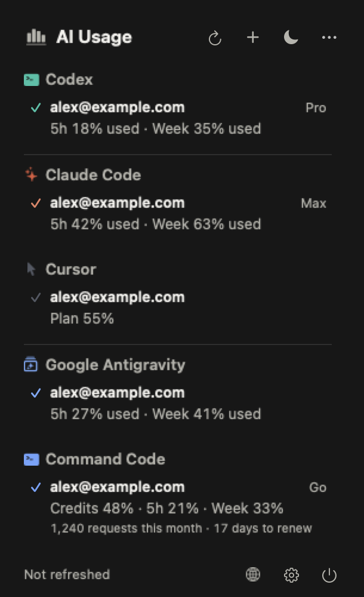
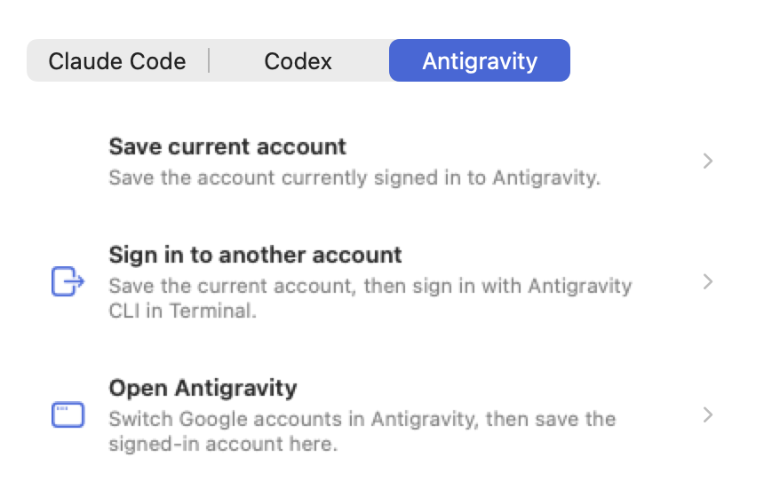

# AI Usage Monitor

A native macOS 14+ menu bar app that shows your AI coding usage at a glance: limits, reset countdowns and several accounts per provider. Built with SwiftUI; the popover uses Liquid Glass on macOS 26.

## Screenshots

Images use sample data, not real accounts.

| Popover (light) | Popover (dark) |
| --- | --- |
|  |  |

Add an Antigravity account:



## Features

- **9 providers:** Claude Code, Codex, Cursor, Antigravity, Command Code, Copilot, Gemini, Grok, OpenCode.
- **Multiple accounts** for Claude, Codex and Antigravity, switchable from the popover. Credentials stay in the macOS Keychain.
- **Menu bar:** icon only, combined usage, a single provider, or the active app's provider.
- **Honest data:** missing values show as unavailable, and a failed refresh keeps the last snapshot marked stale.
- **Widget, CLI and status line:** a WidgetKit widget, `scripts/ai-usage` for quota and JSON reports, and a Claude Code status line.
- **English and Tiếng Việt**, light and dark.

## Install a release

On Apple silicon with macOS 14 or later, install the latest release with Homebrew:

```sh
brew tap thienle99-dev/ai-usage https://github.com/thienle99-dev/ai-usage
brew install --cask thienle99-dev/ai-usage/ai-usage-monitor
```

Or install it into `/Applications` with the shell installer. It may prompt for
your administrator password when permission is needed:

```sh
curl -fsSL https://raw.githubusercontent.com/thienle99-dev/ai-usage/main/install.sh | sh
```

Set `AI_USAGE_INSTALL_DIR` to choose a different install folder, such as
`~/Applications`:

```sh
curl -fsSL https://raw.githubusercontent.com/thienle99-dev/ai-usage/main/install.sh | AI_USAGE_INSTALL_DIR="$HOME/Applications" sh
```

Both commands need a published release; see [release instructions](docs/RELEASING.md).

## Build and run

Requires macOS 14+ and Swift 6 with the macOS SDK.

```sh
swift build
swift run
```

Create a runnable `.app` bundle:

```sh
./scripts/package-app.sh
open "dist/AI Usage Monitor.app"
```

The app lives in the menu bar and has no Dock icon. Open Settings from the popover gear button to choose providers, language (system, English, Tiếng Việt) and refresh interval (1, 5, 10, 15 minutes or manual). Signed release builds update through Sparkle; see [release instructions](docs/RELEASING.md).

## Documentation

- [Providers, accounts and refresh](docs/PROVIDERS.md): data sources, credentials, adding accounts.
- [CLI and integrations](docs/CLI.md): quota and reports, status line, Claude Code side pane and more.
- [Release instructions](docs/RELEASING.md)
- [Technical plan](docs/TECHNICAL_PLAN.md), [feature comparison](docs/FEATURE_COMPARISON.md), [all docs](docs/README.md)

## Reference projects and attribution

The implementation was informed by these MIT-licensed projects; no source code is bundled from them:

- [claude-usage-widget](https://github.com/bozdemir/claude-usage-widget) — usage presentation, Claude endpoint and credential source investigation.
- [codex-usage-bar](https://github.com/CMMUU/codex-usage-bar) — local Codex app-server integration pattern.
- [CodexBar](https://github.com/steipete/CodexBar) — feature comparison and roadmap reference.
